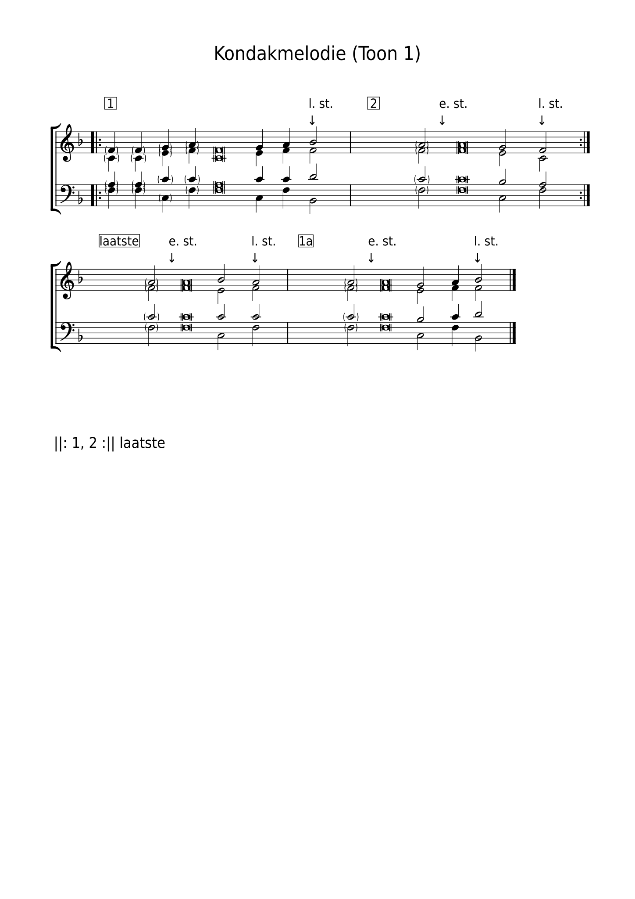

# `kondak-toon-1-groningen`

| Veld         | Waarde                                                                                         |
| ------------ | ---------------------------------------------------------------------------------------------- |
| Soort        | kondak                                                                                         |
| Toon         | 1                                                                                              |
| Bron (in id) | groningen                                                                                      |
| same_as      | —                                                                                              |
| also_used_as | `tropaar`                                                                                      |
| Aliassen     | `hemelum-kondak-toon-1`, `kondak-toon-1`, `kondak-toon-1-liturgikon`, `liturgikon-kondak-toon-1` |

Bronvermelding in de YAML: Koormap Groningen — kondak/tropaar zondag toon 1

Machinebestand: [kondak-toon-1-groningen/template.yaml](https://github.com/orthodox-ronl/VSA-tooling/blob/main/docs/specification-vsa-templates/library/kondak-toon-1-groningen/template.yaml).
